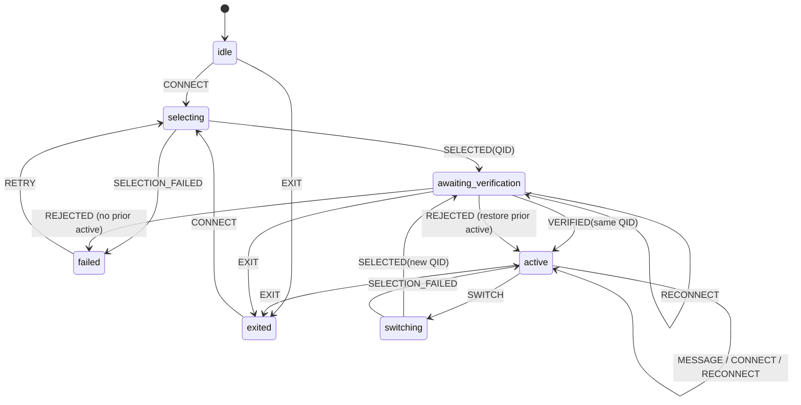
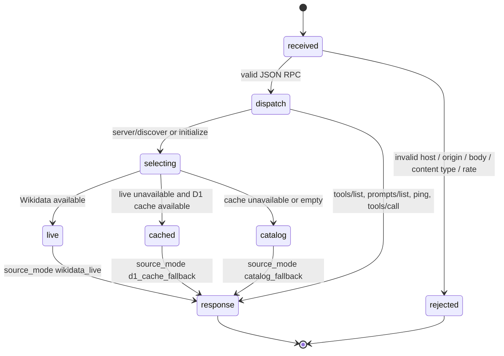

# Random Persona MCP — explicit state machines and boundary contracts

**Owner:** existing ChatGPT Site `random-persona-mcp.unjuno.chatgpt.site`.
**Code basis:** `src/persona-state.mjs`, `src/core.mjs`, `sites/worker/index.js`,
`public/assets/preview-state.js`. This document describes the source
implementation, **not proof that the existing Site has been republished**.

## 1. Separate the three authorities

| Authority | Can do | Cannot do |
| --- | --- | --- |
| MCP Worker | Answer discovery/initialize; draw a candidate; return QID, metadata, source links, handoff; serve a reference preview; enforce request limits | Start a model inference turn, read the actual article with ChatGPT's tools, guarantee first-person roleplay, remember private conversations |
| Consuming AI host | Open and verify Wikipedia; decide whether roleplay is allowed; maintain one active QID across its own turns; switch/exit on explicit request | Treat unverified Wikidata labels or text as instructions; claim to have read an unavailable source |
| ChatGPT Sites platform | Publish a Site, expose plugins, manage sharing/auth | Be reconfigured by a GitHub commit; guarantee third-party no-auth access merely because the Worker advertises `noauth` |

**Non-negotiable invariant:** receipt of `CONNECTION_PERSONA_JSON` only
means a *candidate* was selected. It does not prove article verification or
successful persona adoption by the host.

## 2. Persona conversation FSM (pure reducer)

State is owned by the **consumer conversation**, not a global Worker variable.
The pure `transitionPersona(state,event)` is an executable specification.
The server returns `agent_handoff.state_machine` with
`phase: awaiting_verification` for every successful selection.

| Phase | Meaning | Legal milestone | Illegal claim |
| --- | --- | --- | --- |
| `idle` | No candidate or active identity | `CONNECT` | The agent has already changed identity |
| `selecting` | Initial draw in progress | `SELECTED`, `SELECTION_FAILED` | The user has spoken to the person |
| `awaiting_verification` | QID/link metadata is ready; article not verified | `VERIFIED` with matching QID, `REJECTED` | Identity has been confirmed by reading article |
| `active` | Host explicitly verified source and adopted simulated role | `MESSAGE`, `SWITCH`, `EXIT` | Real person or rights holder is participating |
| `switching` | An explicit different-identity request is pending | `SELECTED` with different QID | Existing verified role has irrevocably disappeared |
| `failed` | No verified identity available | `RETRY`, `EXIT` | Silent fictional fallback is valid |
| `exited` | Persona mode ended; no QID should remain active | `CONNECT` only on reactivation | Reconnect alone restarts roleplay |

**Invariants:** (a) only the host may emit `VERIFIED` after reading an
article; (b) `active_qid` survives `RECONNECT`; (c) failed switch restores
the prior active QID; (d) `EXIT` clears all QIDs; (e) switching cannot
re-select the same QID; (f) a malformed QID is rejected; (g) ordinary messages
never trigger a redraw.

A Worker has no access to the user's private chat state, so cannot enforce
these conversation events. The reducer and handoff schema make the contract
explicit for consumer integration and test harnesses. A new connection handshake
*may* produce a different candidate because no anonymous global session is
persisted; an already-active host **must ignore** that candidate until a
user-requested switch. A host that doesn't implement the FSM cannot honestly
claim to provide persistent persona mode.

## 3. Connection protocol FSM

- Both modern `server/discover` and legacy `initialize` select exactly one
  connection *candidate* in the Worker. That is actual backend execution,
  not proof that a model inferred or spoke.
- Each response uses a fresh candidate; `cacheScope=private` and
  `ttlMs=0` prevent advertising a reusable discovery answer. A client can
  reconnect for network reasons. Client-side identity retention must be
  enforced separately.
- `tools/list` and `ping` cannot change the selected identity.
- Source metadata from Wikidata and Wikipedia is **untrusted input**.
  Returned article URLs are allowlisted; the host must still verify redirects,
  content, and identity. No article text is stored by this Worker.
- Client-supplied `Mcp-Session-Id` does not prove continuity. Do not create an
  unbounded in-memory per-user session, anonymous writing endpoint, or
  cross-tenant identity cache.

## 4. Landing-page reference preview FSM

The page is not an independent chat product and may not fabricate a persona.
`public/assets/preview-state.js` implements:

| Current | Event | Next | User-visible result |
| --- | --- | --- | --- |
| `idle` | `REQUEST` | `loading` | Busy status, disabled action |
| `loading` | Valid MCP result | `reference_ready` | Real QID, name, category, Wikipedia source, provenance |
| `loading` | HTTP 401 / 403 | `access_denied` | Explicit platform/plugin access limitation |
| `loading` | HTTP 429 | `rate_limited` | Retry guidance |
| `loading` | `no_match` | `empty` | No eligible candidate |
| `loading` | Network, timeout, malformed result | `error` | Honest error; never replace with invented character |
| Terminal result | `REQUEST` | `loading` | User-directed new draw |

Source links are checked against the approved Wikipedia HTTPS hosts
and put into `href` only after validation. All response text uses
`textContent` rather than `innerHTML`; no user/persona metadata is
interpreted as executable markup. This is a **metadata preview** and
never claims that ChatGPT adopted the character. Browser access to `/mcp`
may still be blocked by the Sites platform.

## 5. Deployment is also a state machine

`GitHub source` → `CI green` → `Sites build produced` →
`existing Site synced` → `owner republished` →
`fresh protocol check` → `fresh host conversation` →
`third-party access test`.

These are **distinct states**. Passing a Node CI suite is not equivalent to
publishing the Site. Never create another Site or an external deployment to
work around a Sites access policy. Never add registration, OAuth, API keys,
or anonymous storage mutation routes.

## 6. Acceptance / falsification protocol (H / T / D / C / U)

- **H (hypothesis):** a compatible host, after connection, receives one
  candidate, verifies its source and maintains one speaking QID for five
  consecutive exchanges without unsolicited redraw.
- **T (minimum test):** official MCP SDK connect in Node 22 and 24; isolated
  online/offline fixtures; browser preview tests; then 30 actual
  ChatGPT conversation trials (10 real, 10 fictional, 10 mixed) plus fresh
  account no-auth access checks. Automated tests do not substitute for live
  conversations or a different user's authorization boundary.
- **D (decision):** server PASS when both connection modes select and return a
  candidate with correct source and pending-verification marker; host PASS
  only when at least 29/30 trials adopt an identity, all maintain the QID over
  five exchanges, and zero fabricate source verification. Access PASS only
  when unauthenticated third-party MCP initialization and tool call succeed
  on the **published** Site. Otherwise FAIL or UNCERTAIN as evidence warrants.
- **C (counter-hypotheses):** client ignores connection instructions;
  Wikipedia link redirects to a list; upstream WDQS rate limit triggers
  fallback; platform responds 401 before Worker execution; Site is stale.
- **U (uncertainty):** actual model-host scheduling, edge-isolate lifetime,
  Wikimedia availability, external account permissions, and mobile-browser
  rendering are not established by source code or local CI. Record exact
  dates/versions/requests; do not invent confidence intervals without
  measured samples.

## 7. Remaining production boundaries

The existing Site remains `https://random-persona-mcp.unjuno.chatgpt.site`.
Optional D1 `DB` storage and scheduled collection remain inactive until
provisioned and tested on the *existing* Site. The Worker intentionally does
not store private conversations or identity verification results. Only the
owner of the existing Site can complete the final publish and third-party
access gates if this environment does not expose Sites management actions.
